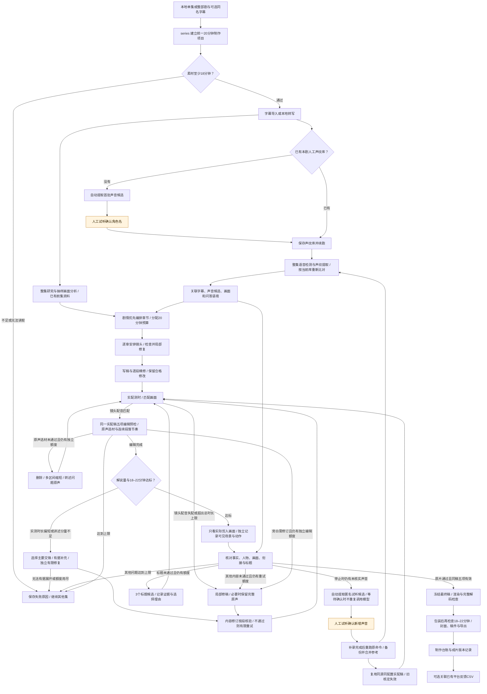
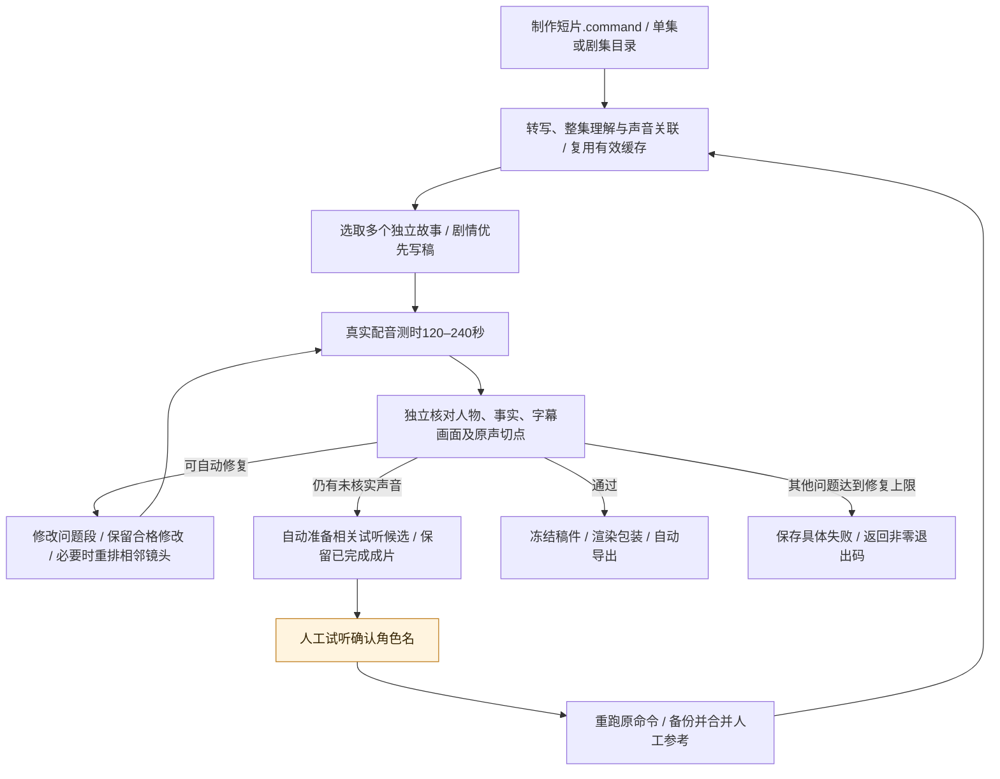

# 剧作工坊 AutoClip

把单集电视剧或整季文件夹，转成中文解说长片；正式制作统一目标20分钟、成片验收18–22分钟。短片使用独立入口。

**剧情优先是整个项目始终遵循的创作规则。** 先讲清人物处境、事件起因、行动、结果与场景承接，再在必要转折分析选择和代价；旁白可以只是自然转场，不要求每段都有观点。长片、短片和测试样片都遵循这一原则，不按集切换。时长要求独立执行：不能为达标重复凑字、强加分析或删掉关键剧情；无法同时满足剧情完整与时长要求时，自动修复到上限后报告失败，不将就交付。

**口播表达也是全局规则。** 长片、短片、局部改稿、配音缩写、缓存续跑、包装及独立导出共用检查，观众听到的正文不得出现“字幕里说”“字幕告诉我们”“从画面可以看出”“画面中标注的说话者”等制作核对话术。写稿和自动修复直接讲剧情；有问题按段重写，修稿同时读取当前剪入区间画面和引用字幕图，内容修订先按段独立核验，确认解决问题后再重新测时和整片审核，达到上限仍不合格则不交付。关闭精修、使用冻结稿或命中旧缓存都不能跳过实际口播检查，无需额外命令参数。内部核对记录和剧中原声不当作旁白误拦。

自动内容核对按单段隔离旁白，只提供此前与当前稿件，避免后文替当前事实作证；原声剪辑仍读取相邻片段以核对切点，可引用结束后8秒内的对白作边界对照；这不表示该对白已剪入，旁白仍不能借未来对白证明当前内容。人工确认过的声音保留其准确原片版本与时间范围，不因重新扫描的相似度不足而丢失，也不扩展到邻近声音。

新增「声音确认台」：用 CAM++ 整理前几集的候选声音，试听原声、查看原片时间及前后画面，由人确认角色名并建立声纹库。支持无名角色、排除、撤回及后续声纹候选比对。使用方式见 [人工声纹确认](docs/人工声纹确认.md)；准备资料后可双击 `听声音认人物.command` 打开。

这是一套可执行的 Python 流水线：本地识别对白 → 人物背景与分集研究 → 抽样画面理解 → 逐集选题 → 解说脚本 → 自动审片 → 配音 → 原声穿插 → 字幕与竖屏排版 → 批量导出。

后续工作按 [分阶段迭代计划](docs/迭代计划.md) 推进，逐项记录交付物、验收标准与完成状态。第一集自然解说重制已完成，18分16秒，通过连贯性、分析、重复与自然度四项整稿检查；第十集连贯解说与视觉重做为18分38秒，旧版保存在历史版本。三条历史短片已完成；下一项为多集连续制作、失败隔离及中断恢复的真实验收。

新稿会先完成本集分段分析，再结合最近三集已有台词、研究与交付稿理解前情；支持按成片时间改一句解说，并跨稿件复用未改片段。方法和独立命令见[跨集理解与局部修改](docs/跨集理解与局部修改.md)。

**可以自动生产，但模型审片通过不等于事实正确。** 已出现将八阿哥行为归给太子的错误。时间线、配音和解码有程序检查；人物归属、剧情因果和观点仍可能误判。前置研究记录证据与疑点，已接入独立人物归属拦截，但画面错配与误拒仍待改进；尚不把这一阶段当作稳定批量出片能力，详见[人物核对与前置研究](docs/人物核对与前置研究.md)。

## 整剧自动制作：只在声纹建档时人工核对

更新：2026-10-25。统一入口 `series`：给定本地剧集目录，系统自动建立项目、识别集数顺序、整理字幕与前情、关联声纹候选、编排章节与镜头、写稿、配音测时、内容审核、局部修复、渲染、包装和导出。**人工步骤只保留声纹建档及补录；本轮范围到自动导出，不包含平台发布。**

**正式制作同一项目所有集共用一套规则：目标1200秒，真实配音加原声及最终导出均须1080–1320秒。** `--config` 可更换模型、音色等设置，但不能放宽正式时长；旧配置中60秒下限也会被统一规则覆盖。素材不足18分钟会在转写、声纹扫描和模型调用之前失败；其他内容或时长问题有限自动修复，仍不合格则返回失败，不改成短片交付。第七、八集旧15–20分钟配置、第九集旧自然时长配置只用于历史定稿复现，不能决定新正式任务的长短。

第八、九集此前已经用过人工声纹库辅助制作；现在 `series` 将候选读取、当前库重新比对、逐条字幕关联和自动审核串联起来。机器候选不回写人工参考库。新入口不要求人工整理脸部参考图，也不伪造旧 `render-sample` 要求的人工审阅记录；使用独立、绑定最终稿和原片的机器审核记录。

### 连贯解说与字幕样式

剧情优先包括讲清人物处境、行动依据、选择与眼前后果，不能退化成原声片段之间插两句动作复述。正式长片按章组织讲述，主要解说段通常90–170字；先提供合法、连续的画面区间，再安排解说和关键原声。同一画面区间只能选一次，实际保留原声的全部对白都可作为后续回顾依据。

正式长片在所有事实修复、真实配音测时之后，还必须通过整稿连贯性、分析内容、重复复述、口播自然度、原声选材与节奏五项检查。每个问题绑定最终稿里的实际原句与段号，退回自动修复后重新测时、核对事实和整稿。核定绑定稿件内容，缓存或后续改字不能沿用旧结论；同一规则适用于所有剧名和集数。整稿听感检查只读取实际保留的原声和最终旁白，附原片时间区分多次相似事件；被旁白覆盖的对白不能冒充观众已听过的原声。局部编辑修稿另读原片依据，独立事实审核仍对照原片。局部修稿先验证是否真正解决编辑问题，再核事实；换词复述不能仅因事实正确而通过。

原声优先保留值得亲耳听的关键台词、交锋、决定和人物转折。洗澡、换衣、叫人等生活过场若不推进本片主线，优先删除；必要信息可以简短转述，只有一句有用就只留那句及必要回应，不为一个名字保留整段闲聊。这些场景没有关键词黑名单，真正影响主线时仍可保留。

连续原声按**成片相邻顺序**累计，原片时间有跳跃也不重置；达到90秒重点复核，不是强制打断线，完整而持续推进的交锋可以通过。整稿选材可要求删除、缩短或转述问题原声，不强插空旁白。整组有多个问题时逐段列出，缩短须在当前段内仍有值得保留的完整对白；当前整段都是待删过场时用删除，不把其他片段的有用对白当成本段保留理由。同一段原声缩短时可保留最多3个按时间排列、互不重叠的区间，删掉中间重复，保留两头必要交锋；每段都须在原区间内、保留完整对白，合计时长必须缩短。开场仍只允许一个连续区间，转述仍只有一项且只能用本段证据，不能改动其他段落或增加剧情。修改后重新测时、核对原片及五项整稿，旁白修稿失败后恢复原声也不能跳过选材检查。选材修复采用独立的有限额度，各步骤仍有限重试，18–22分钟要求不变。新规则默认生效；旧四项核定不能跳过新增检查，已有影片不会因更新代码自行重制。

口播自然度单独核验：把人物的具体处境与交锋讲明白，避免“拆掉某种叙事”“收回解释权”等抽象标签、普通请安硬拔高、每段套用“复述动作→上升意义→总结一句”。没有禁词不等于自然；问题绑定当前原句，局部改好后仍重做事实、测时及整稿检查。写稿、精修、局部修复共用此规则，审核缓存绑定新版本。第十集此前的三项整稿通过记录不包含新增自然度验收；第一集自然解说版现已交付18分16.496秒，四项整稿与原片核对通过；具体记录见下方验收说明。 主场景的解说分量按全片核验，不对每个90秒章节强制两段长解说或固定占比，避免普通转场为配额硬加分析；1800个有效字、30%实测占比及8个展开段的全片防退化下限保留。

为发现修稿后的退化，正式18–22分钟长片另检查：至少1800个有效解说字、实测解说占比至少30%、至少8个80字以上的展开段。这些是**防止碎片化的下限，不是深度评分**；仍需核对推理是否由已展示的事实支持、段落是否连贯，不能靠空话凑字数。短转场不强制扩写，预测和分析不能冒充事实。 局部旁白在有限修订后仍未核实，可保留该段1–40秒连续原声；仅恢复完整对白，不跨入邻镜，不增加旁白身份主张。替换先作为待审核中间稿保存，再统一平衡全片解说量和时长；正式定稿仍须满足解说分量，重新配音测时、核对原声切点和五项整稿，不能用大量原声规避解说要求。

事实纠错逐段保护已有展开段：原来达到80个有效字的主要段落，不能被普通局部纠错压成不足80字的过场。整稿编辑若指出重复或衔接问题，可以按绑定当前原文的意见精简该段，不为保字数重复问答；同批存在关键交锋解释不足时，先补清该处。正式长片的修订中间稿不会仅因全片暂时不足1800字或粗估时长偏短而提前中止，仍保留引用、画面范围、顺序和完整对白检查；系统接着实配测时并按真实缺口平衡。最终定稿、渲染及导出仍须满足全片解说分量、实测时长、独立原片核对和五项整稿检查。实测配音超时的压缩仍按画面余量处理。字数检查只负责拦截明显退化，不代替内容判断。

核验不能因为机器转写错字而删掉正确分析：出现对白争议时，按问题中的编号或引用原句补取原片字幕，再独立辨读、重新核定。人物核对区分发言者与被提及者，例如“有人认为八爷有五成胜算”不等于八爷自己发言；被提及姓名必须明确出现在所引对白中，不能用声纹候选补出未说过的姓名。 被提及姓名若仅因转写字形不符而被拒，会按实际引用编号补取原片字幕图、独立辨读后再核验；字形辨读只用于对应编号，不改原转写、不补人物姓名或声纹确认，姓名正确也不代表动作与归属已核实。

同段多个角色分别记录身份依据：可以一人由声纹和语境核实，另一人由明确称呼与回应核实；不能借用别人的声纹，也不能漏掉其中一人。服务中断、请求额度用尽或核验响应格式错误先续跑自动核对，不从旧问题直接生成新的人工声纹确认要求。 被提及者的“八哥／八弟”等排行称呼，只有同组实际引用对白已交代皇室父子语境时，才可按同一排行核对“八阿哥”；不会据此补出本名、认定发言人或更新声纹库。当前剧已登记角色表中同一角色的称谓可规范比对，例如“四阿哥”和人工库“四爷（雍正）”；仅适用于唯一对应的本剧角色，不借其他人的声音。旧称谓策略产生的声纹等待会先重新自动核验，仍有真实声音缺口才继续等待人工。

整稿连贯、讲述平衡、选材等编辑问题，即使说明中出现“人物”或“身份”，也不会生成声纹人工任务；只有源片声音或人物归属确实尚未核实时才补录。新增任务保存问题所属阶段及绑定稿件、审核记录；旧编辑任务可自动标为已替代，旧版未记录阶段的任务只有能可靠绑定当前审核且确认属于编辑问题时才解除，真正或无法确定的声音缺口仍保留。

当前 DeepSeek 接口对有争议的复核、局部修订核验和最终整稿检查启用有界的 low 推理模式；核验可能更慢，仍用原来的模型和接口，并遵守当前请求策略及步骤重试额度。推理请求与普通请求使用不同缓存，内部推理内容不写入项目缓存。仅被提及姓名的引用校验失败交回自动核验，不生成新的人工声纹任务。

局部修稿核验也会对明确的ASR字词争议补取原片字幕、独立辨读，再核整句事实，不只处理人物引用格式错误。若审核仅因候选不是逐句人工确认而拒绝，先按“候选加实际语境／明确称呼及回应”的既有标准有限重核；不要求把声纹候选等内部状态写进口播，真实声音冲突和不明归属仍拒绝。 被提及人物的引用不完整时，反馈会展示该项实际引用的编号与文字，并给出本批合法范围内可对图复核的同名字面候选；字幕独立辨读覆盖ASR，候选不自动补入引用或认定身份，真实拒绝仍须修复。

被提及皇子的称谓也同时核对原片和实际旁白：在已引用的皇室语境中，审核记“八阿哥”、正文按不同角色关系说“八哥／八弟”，可以指向同一排行。不因审核标签与正文称谓字面不同而重写；不同排行、无实际提及、仅靠排行补本名仍拒绝。

片内标题采用楷体、象牙白与暖金分层，配细线装饰；解说字幕采用黑体、半透明深色衬底与金色细线，放在原画字幕以外的安全区。长句均匀分行，短列举合并显示，避免固定字数切分产生单字闪屏；完整句末仍保留停顿。保留原声时不另外盖一层字幕。样式随默认制作命令生效，渲染缓存绑定样式版本；本机预览已经用实际画面检查，其他系统缺少字体时仍由FFmpeg字体回退。

### 标题也由系统审核

长片、短片使用同一规则：**准确交代人物与行动，用成片中充分展开的冲突吸引观众，优先12–22字、最多24字**。避免“事件之后：概念与人物”式目录标题、公文式缩写、空泛夸张和无依据的设问；人物预测或传言不得写成事实。标题可以聚焦长片的一处主要冲突，不必罗列所有章节。

写稿时应用规则，成片审核再独立核对标题的事实、看点和表达。不合格时自动提出3个不同候选，记录证据与选择理由，只修标题，再核对通过后渲染；候选自评不能代替审核。规则版本进入长短片核定缓存，旧版本核定不能跳过新审核。无需新增命令参数或人工确认标题。封面优先从标题核定证据对应的已保留原声镜头选图，避免标题讲后段冲突、封面却只取开头无关人物。

标题、角度和钩子按本片实际保留的完整剧情核查，不套用某一段旁白的结束时间；概述可以省略中间问答，但不能改变人物、因果或结果，也不能借用未选剧情或其他集。若审核误把全片信息限制在局部片段，会携带具体错误有限复核，仍由独立审核决定是否通过。

第十集当前标题为《八爷要拿人，十爷为何护着道士？》，与新版连贯解说一同通过原片及整稿核验。视频内标题、封面、文件名、清单和最终稿同步更新；此前《道士拆出“皇”字，八爷为何下令拿人？》等旧版保存在导出目录的“历史版本”。

### 已实现的流程

正式长片先完成当前实配稿的整稿编辑与选材预检；编辑中间稿即使暂时偏短或解说量不足，也先完成删改，再统一补充有据讲述、重新测时及五项检查，最后做整片原片核验。事实修订后返回实配和五项预检，最终只批准事实与五项均通过的同一稿。预检单独保存，不是原片批准，短片既有顺序保持。

图中橙色只表示人工声纹确认，包括首次建档和后续补录。错误自动重试到配置上限，仍不通过则记录失败并继续其他集，不等待人工改稿、不把失败稿当作成片。



### 一个入口启动和续跑

安装依赖、FFmpeg、字体及模型服务密钥的方法见下方“从零安装”；声音特征依赖见[人工声纹确认](docs/人工声纹确认.md)。默认配置是通用的 `configs.series.toml`，不用先手工填写章节、人物备注或逐段审阅文件。

完成依赖、密钥和本剧声纹建档后，**一条命令完成制作到导出**，无需再逐个执行写稿、测时、审片、渲染或导出命令：

```bash
./制作长片.command /path/to/剧名 --library /path/to/registry.expanded.json
```

本机第二集选材效果试跑（复用已确认声音和全集扫描，不用增加规则开关）：

```bash
./制作长片.command "/Volumes/ExternalSSD/Data/videos/原片/雍正王朝/02.mp4" \
  --series "雍正王朝" \
  --library "output/声音确认/人物补录/registry.expanded.json" \
  --voice-manifest "output/声音确认/全集扫描/manifest.json" \
  --output "output/整剧制作/雍正王朝-第二集-选材优化版"
```

相同命令的Python入口是 `.venv/bin/python -m autoclip series /path/to/剧名 --library /path/to/registry.expanded.json`。生产进程直接执行仓库中的流水线，不需要Codex会话接力操作。输入也可以是一个完整视频文件（单集时可用 `--series 剧名` 指定剧名）。不填 `--output` 时，自动使用仓库下的 `output/整剧制作/<素材名-路径指纹>/`，同一素材路径重复运行会续跑。终端结束时显示 `exports` 导出目录和各集实际时长；输出包含MP4、同名JPG封面、最终稿及清单。

终端出现 `partial_failure` 或“本次未产出成片”表示制作失败，`exports` 只是预定导出位置，不能据此判断已经有MP4。具体原因保存在输出目录的 `project-report.json` 和 `series-status.json`。章节规划若重复窗口、增加不存在的编号或错引对白，会在写稿前拦截并有限修复；正式长片按实际窗口编号填写一次原声或旁白选择，修复时使用同服务、同模型的有界推理核对，仍在各步骤的有限重试内执行。修复问题后重跑原命令，可复用已有转写、分析和有效模型缓存。

内容核对会逐批显示开始、完成及待修数量，完整进度另存运行目录的 `automatic-review-state.json`。审核响应的格式或引用校验失败时，反馈包含轮次、上次原始响应、具体错误及当前可用段号、原句或区间边界，有限重试核查本身，避免只重放相同失败缓存；核查格式错误不会直接要求作者重写正确稿件，真实内容错误继续进入修稿。原声选材修复的拒绝记录另保存修改前稿件及问题摘要，修复失败后采用同模型有界推理。耗尽重试后续跑仍携带失败反馈与恢复轮次，成功恢复后的请求可以缓存。Ctrl+C、终止信号或关闭终端时记录中断阶段；强制结束或断电无法执行退出处理，下次取得项目独占锁后会识别残留 `running`，保存 `last-interruption.json` 并按有效断点继续。恢复能力不代表内容必然通过，正式时长与完整审核要求仍须满足。

审核若返回本批不存在的单位编号，反馈会逐项给出非法编号和允许编号，并把问题、备注及主画面编号约束到当前批次；跨镜头问题必须绑定受影响的真实片段。恢复时保留失败上下文和恢复轮次，避免再次命中同一错误响应；真实拒绝和修订要求仍保留，不靠删除问题恢复。

审核响应先做有限格式兼容：无内容的多余扩展字段可自动清理；单条结果中错放的备注会保留到该单位的备注通道，要求修订的说明仍阻止通过。原始响应保持不变，清理或搬移操作记录为 `format_repairs`。非空未知字段、缺失必填内容、越界引用及真实拒绝仍须核对，不能通过忽略字段放行。已缓存的格式失败响应若能按上述规则恢复，会重新跑现有引用和人物依据检查，避免为清理一个空字段再次请求模型；全片与局部修订核验共用此处理。

编辑删减后若实测总时长不足，或全片讲述分量不足，系统先在有实测画面余量和原片证据的候选中选择主要交锋，补充尚未讲清的必要处境、选择约束或因果，再重做实配、原片和整稿五项核验；不会仅为时长或字数展开铺床、端水等日常过场。1800有效字、30%实配旁白、8个展开段及正式18–22分钟要求均保留。没有可据实展开的位置就停止，不编造或用空话放行。讲述量不足时不能复用旧身份问题要求人工补录。局部修稿在首轮失败后使用同服务、同模型的有界推理，按真实错误继续修订。

正式长片将时长协调 `timing`、源片事实 `content`、整稿编辑 `editorial`、原声选材 `selection` 和讲述平衡 `commentary` 分别按 `repair_attempts` 限额。正常删重复、补衔接等编辑不会耗尽事实修复额度，早先事实纠错也不会挤掉之后的整稿编辑机会；所有阶段仍有明确上限，同稿同问题再次出现或提案没有实际修改时停止。批准只在实测与全部审核通过后创建；渲染绑定批准稿件，导出再次检查真实视频时长。 原声切点修复必须改变实际起止区间，只改内部说明或引用编号不算有效修复；会携带具体错误继续有限修订。局部重试耗尽且整稿没有实际变化时，直接保留失败，不再重复整片测时和审核。

仓库自带的长短片配置采用 `api_budget_mode="steps"`：不再把正常制作按累计100次模型请求截停。单个网络请求最多尝试3次，各制作步骤仍按 `repair_attempts` 有限修复；同一稿件反复出现相同问题时明确停止，无改动提案不会重复送审。终端会显示新增请求编号和局部修稿进度，`project.json`、`usage.json` 记录有效请求策略。切换该策略不改变已有稿件与缓存指纹。需要自行限制总请求数时，可显式设 `api_budget_mode="fixed"` 并配置 `max_api_calls`；仅有旧配置且未设新模式时保留原固定保护。

```bash
# 自动创建项目；剧名默认取素材目录名，支持 --series 显式指定
.venv/bin/python -m autoclip series /path/to/剧名 --output output/整剧项目

# 已有声纹库时直接使用；可复用既有全集扫描的特征清单
.venv/bin/python -m autoclip series /path/to/剧名 --output output/整剧项目 \
  --library /path/to/registry.expanded.json \
  --voice-manifest /path/to/全集扫描/manifest.json

# 首次没有声纹库时，系统准备好候选后提示唯一的人工步骤
.venv/bin/python -m autoclip voice-review --output output/整剧项目/voice-enrollment
# 确认后再次执行同一 series 命令，自动继续；已有路径会记在 project.json

# 只处理前一集（仍要求正式18–22分钟）；或只准备字幕
.venv/bin/python -m autoclip series /path/to/剧名 --output output/整剧项目 --limit 1
.venv/bin/python -m autoclip series /path/to/剧名 --output output/整剧项目 --stage prepare

# 制作台账自动生成；已有平台数据时可额外关联，不自动发布或抓取账号数据
.venv/bin/python -m autoclip series-report --output output/整剧项目 \
  --feedback /path/to/feedback.csv
```

`--config` 可覆盖模型、音色等设置，不能关闭剧情优先或放宽正式时长；`--model-path` 指定本地 CAM++ 权重目录，`--voice-python` 指定声音依赖环境。默认优先使用仓库的 `.venv-voices/bin/python`。`--voice-manifest` 是含声音特征及素材指纹的清单，不是只有人名的比对报告。未提供特征清单时，生产入口自动扫描本集完整语音，不复用建档时的稀疏试听选样。CAM++ 与 FSMN-VAD 可使用本地权重，未指定时按模型标识查找或下载缓存。配置、声纹库、特征清单路径会记住；`--limit` 和 `--stage` 是本次运行选项。`project.json` 保存统一用途、创作规则、时长规则及实际生效配置，不能为每集偷偷切换长短或叙事优先级。

短素材开发验收必须显式添加 `--test-sample --config /path/to/测试配置.toml`，配置中的时长仅在此模式生效。默认放入 `output/测试样片/`，导出文件加“测试样片”前缀，清单和稿件也标明用途；测试与正式项目不能共用同一输出目录，测试续跑仍必须显式加该选项。此前210秒素材生成136秒视频属于历史短样本验收，不是20分钟正式长片验收。真正要生产短视频时使用显式的 `produce` 入口。

首次没有人工声纹库，或制作中停止时仍有可提取的人物声音疑点，返回退出码2，状态为 `waiting_voice_confirmation`。系统自动准备匿名试听候选；在声音确认页确认认出的角色并点击“保存本轮，返回自动制作”，再运行原制作命令即可。仅保存单段姓名还不会合并原库。完成本轮后自动备份并合并人工参考；在原片、字幕、配置、前情及其他运行条件一致时，长片复用已实配稿和分析资料，再按新库重新测时、完整审核，旧批准不随稿件复制。模型响应的格式、引用和身份依据标注矛盾先重核审核本身，不直接要求写稿器改字。服务或审核响应中断后，优先接上当前运行已保存的实配稿，重新测时和核对，不从补录前的旧稿重放修订。待确认时重复执行不会继续调用模型改稿，其他集照常处理。部分集失败返回1，成功或准备完成返回0。`--stage prepare` 在尚未建声纹库时同样先准备声纹确认资料。

第十集重制长片 **《八爷要拿人，十爷为何护着道士？》已导出，实际18分38.018秒（1118.018秒）**，满足18–22分钟。全片44个镜头、23段解说，2239个有效解说字，其中17段达到80字；实际解说约487.8秒，占43.6%。31批原片核验、整稿连贯性／分析／重复检查、完整解码、音视频轨与时长检查通过，成片720×1280，封面1080×1920。字数和占比只作防退化指标，不代替深度评价。交付位于 `output/整剧制作/雍正王朝-第十集/episodes/成片/`，包含视频、封面、清单、最终解说稿，另有浏览页；旧版保存在“历史版本”。同一制作命令复跑新增模型请求0次，5个交付文件内容哈希不变。人工库仍为23位角色，本轮没有自动增加人名。开发过程包含人工编辑反馈和抽帧核对；上述记录不代表完整主观听审或任意整季无人干预的内容质量已经验证。

### 短片：单集多条与整剧批量

短片对应一条命令 `制作短片.command`，直接运行既有 `produce` 流水线，自动完成选题、写稿、配音、审核、剪辑、封面和导出；结束后退出，不额外启动浏览器服务。剧情优先同样适用于短片。默认配置每条目标190秒、验收120–240秒。

```bash
# 从第十集最多推荐3个新故事，通过审核的分别导出为短片
./制作短片.command /path/to/剧名/10.mp4 \
  --library /path/to/registry.expanded.json \
  --max-new 3 --output output/短片制作/第十集

# 处理整个剧集目录；每集最多推荐3个新故事，不是整个目录只做3条
./制作短片.command /path/to/剧名 \
  --library /path/to/registry.expanded.json \
  --max-new 3 --output output/短片制作/整剧
```

`--max-new` 控制**每集、本轮**最多推荐多少个新故事，默认3，允许1–6。它既不是“只处理几集”，也不是保证最终出几条；同一集有多个完整且不同的故事可以出多条，没有合格故事也可能0条。此前命令中的 `--max-new 1` 只是单条试跑的上限。输入一个文件就处理该集，输入目录就逐集批量处理。视频、封面、清单和最终稿导出到所选 `--output` 下的 `成片/`；不指定输出目录时沿用短片配置中的历史路径 `output/新片-长版/成片/`。

长短片共用同一份本剧人工声纹库。短片的 `--library`、`--voice-manifest`、`--model-path`、`--voice-python` 与长片含义相同；路径保存在输出目录的 `short-project.json`，同一项目续跑可省略。没有库时自动准备声音候选并以退出码2停在唯一的人工声纹确认步骤，确认后重跑同一命令。不要求人工整理脸部锚点，不能通过关闭旧 `identity_gate` 跳过新声纹及画面审核。

短片默认扫描整集语音，再按当前人工库重新比对并关联字幕，写稿和核对都能读取声音候选；最终稿经实际配音测时后，复用长片的逐项人物、事实、画面及场景承接审核，核定后冻结文字渲染。候选声音仍须结合画面与明确称呼/回应；未知或冲突不强行认人，不能把说话人自动当成行为者。模型审核不能保证永不误判。

短片实际验收为 **120–240秒**，目标190秒。字数估算与真实配音有误差，草稿上限保留20%的估算余量，成片上限仍为240秒。“字幕证据没落在画面区间”表示所引用对白的时间与镜头不匹配，并非原剧没有素材；日志会列出镜头及引用时间。程序会保留失败草稿，证据问题只改受影响旁白及其依据，不能把旁白全部替换成原声避开检查；开场或倒序问题修复对应时间线窗口。所有改稿仍须真实测时及独立声纹、事实、画面审核。零出片返回失败退出码，避免把运行结束误当作交付完成。细节见[时长预算与修复](docs/时长预算与修复.md)。

短片制作遇到经过独立审核仍未核实的人物声音时，会自动从相应证据抽取最多12段试听候选，生成声音确认页，不预填角色名。使用日志中的 `voice-review --output "候选目录"` 打开，试听并确认认出的角色，点击保存本轮后重跑原制作命令。系统会备份原库、只合并已完成本轮的人工具名参考，再按新库自动核对稿件。确认前重复制作命令只提示等待，退出码为2，不对同一身份疑点继续收费改稿；已通过的短片仍可导出。此步骤只核实声音，不要求人工改稿、核对字幕或调整切点。



短片遵循上述全局口播规则，也拦截未交代引用的角色自称台词。旁白审核读取原片字幕图，机器转写明确标为待核实依据；发现冲突先核对原片，不要求正确旁白迎合转写错字。修稿后重新配音、测时和审核，单条重做保持原选题的导出顺序。详见[时长预算与修复](docs/时长预算与修复.md)。

断点续跑或只更新声纹参考时，短片优先沿用同一原片、字幕、配置及选题下保存的已核定稿或实配稿，重新测时并按新库完整审核，不重新编写整个故事；旧核定不随稿件复制，未通过仍须自动修订。

重复同一命令会续跑；只有当前声纹、字幕、配置、最终稿及审核画面均匹配的已完成短片可以跳过，声纹库或核对版本变化会重新核验。旧媒体保留，但旧人物锚点流程或已过期的审核不能直接当作当前交付。需要另开一轮挖掘更多故事时使用新的 `--output` 批次目录，历史成片参与去重，不把反复执行同一命令等同于每次保证新增3条。短片项目与长片项目使用不同输出目录，声纹库可以共用。

### 已补齐的连接与实际边界

| 能力 | 当前实现 | 验证与边界 |
| --- | --- | --- |
| 新剧初始化与整季调度 | 自动保存项目配置、自然排序数字/中文集数、逐集处理、失败隔离、阶段断点 | 输入是本地视频；软件依赖和密钥须已安装配置，不负责搜寻或下载剧集 |
| 人物证据自动关联 | 默认对整集做语音检测与声纹提取，根据当前人工库重新比对并关联字幕；自动审核结合画面与问答；冲突保留未知并触发修订 | 不把说话人自动当成行为者；声纹匹配和机器审阅仍可能误判 |
| 章节预算与局部镜头修复 | 按20分钟给出章节参考预算，允许章节之间调配；写稿前核对全片18–22分钟及最多95个正文镜头；校验顺序、引用、对白边界，失败章有限修复，停止启动后续付费工作 | 连续长原声在完整对白边界无删减拆段；总量不合格只协调相关章节，配音与最终导出仍须实测通过，不靠空话、重复或静帧填充 |
| 自动内容审核与定稿 | 覆盖标题、观点、口播和原声镜头；严格检查审核单位、证据与画面引用；测时后先独立观察实际剪入画面，再对照稿件审核，防止混用此前字幕图；内容修订先按段核验，再重新测时和整片审核；每批最多3项、最多2批并行，连续原声单独核对剪辑，来源时间精确相接的内部段号边界不当作删剪；逐段读取完整前情和后续两镜衔接，标题等全片信息读取完整稿，后文无关修改不重复请求前段 | 保存 `automatic-review.json`，不冒充人工认可；无法通过的内容不会交付 |
| 自动渲染与导出 | 冻结核定文字，完整解码检查，水印、封面、稿件和浏览页自动生成；交付前重新读取实际视频时长，缓存成片也检查 | 不包含平台发布；既有 `render-sample` 人工核定路径保留兼容，不是新入口的必经步骤 |
| 续跑与参考变更 | 阶段结果与产物指纹都匹配才复用；声纹补录后沿用同源同配置实配稿、重新测时审核；每次审核保存准确稿件快照，后续测时覆盖工作稿不影响声音定位 | 旧批准不复用；同一项目同时只允许一个生产进程；模型/素材/配置等变化会生成新运行目录 |
| 制作与反馈记录 | 自动统计完成/失败、调用和修订，生成版本ID；可选按版本关联平台、发布时间、播放量和完播率 | 没有账号数据不推断传播效果；反馈导入不是自动发布或自动获取平台数据 |

最近完整回归为 **909项通过、3项跳过**。自动测试覆盖统一正式时长、旧配置不能放宽、过短素材在模型调用前拒绝、独立阶段修复额度、中间稿实测恢复、多区间原声缩短、审核错误精准重试、编辑与声纹任务分流、全片标题核查范围、测试与正式项目隔离、真实 FFmpeg 导出、缓存复跑、参考变更失效和失败审核拦截，其中模型与配音使用固定测试数据。第二集仍在公开制作入口进行真实验收，尚未记作成片通过。命令行已实测拒绝此前210秒短素材，即便指定旧测试配置也返回失败、模型请求0次。另此前已用第九集的210秒独立素材完成一次**真实 Go Flash + Edge 配音**自动验收：从已有人工声纹库及真实分析缓存续跑，通过实际测时、逐项内容审核、渲染及包装，导出 **136.018秒、720×1280成片**、1080×1920封面和最终稿。复跑新增模型请求为0，5个交付文件内容哈希保持一致。仅复用已确认声纹库，未复制旧定稿或提供人工审阅答案；没有平台发布。详细过程、失败修复与限制记录在[迭代计划](docs/迭代计划.md)。**该短样本只证明流程连接；第十集整集正式长片已另行完成上述验收，多集和整季内容质量仍待验证。**

第一集自然解说重制已交付《赈灾缺银，四阿哥为何开口借官服？》，**1096.496秒（18分16.496秒）、720×1280**，38个镜头、15段旁白、1810个有效解说字，14段达到80字；实际旁白393.888秒，占35.9%。原片与最终整稿四项检查通过，实际渲染文字与核定稿一致；视频、封面及最终稿已导出，封面和字幕样式另经抽帧检查。原命令复跑新增模型请求0次，5份交付文件哈希不变，23位人工声纹库及原片未改动。本地交付目录为 `output/整剧制作/雍正王朝-第一集-自然解说版/episodes/成片/`，验收记录位于该项目的 `diagnostics/natural-delivery/`。**本轮包含Codex定向改稿与原片抽帧核对；自然度通过不等于观众认可，也不证明任意新集都能冷启动一轮自动成功。** 实际听感以成片评价，后续仍需多集和中断恢复验收。

第十集44.2分钟整集素材当前交付为 **3条真实短片**：226.413秒《死谏反被将一军》、227.908秒《求差事被翻旧账》、151.027秒《当众拆白加王直指八爷》。这批短片验收时人工库为20位角色，当时新增人工参考是用户确认14:25.840–14:31.520的声音为佟国维。用户指出第二条“字幕里说”的问题后，已补上写稿、修复和渲染的统一口播拦截，重新制作前两条，第三条保留；同时纠正将ASR错字修订备注误当作正确旁白改稿要求的问题。原片字幕核对还修正了“理藩院”“守监”等转写错词，以及第三条角度中“爵禄”被误写为“绝路”的问题。三条均绑定当时的20位人工库、最终稿和审核画面，完整解码、音视频轨及120–240秒检查通过；同一命令复跑新增模型请求为0，8个交付文件内容哈希不变。随后长片补录使人工库增至23位；这些短片尚未按新库重新验收，历史媒体保留。本集结果不表示自动审片没有误判，也不保证每集三条产量；本集正式长片已另行通过23位参考下的自动审核与导出，不能据此声称整季质量均已验证。过程与限制见[迭代计划](docs/迭代计划.md)。

项目产物：

```text
整剧项目/
  project.json                 素材清单、剧名、统一时长规则、生效配置和声纹路径
  series-status.json           本轮各集结果、失败原因与运行目录
  production-metrics.json      本轮调用、修订与完成/失败统计
  reference-impact.json        声纹库变更影响（发生变更时生成）
  project-report.json          当前交付版本与可选平台反馈
  feedback-template.csv        按 production_id 关联的反馈模板
  voice-enrollment/             首次声音候选及人工确认
  episodes/<集数-指纹>/
    status.json / results.json  当前状态与成片索引
    runs/<输入指纹>/stages/     各阶段完成记录及产物指纹
    runs/<输入指纹>/voice-evidence.json
    runs/<输入指纹>/automatic-review.json
    runs/<输入指纹>/delivery-check.json  用途、时长范围、实际视频时长及交付结论
  episodes/成片/               视频、封面、清单和最终稿
  episodes/index.html          本地成片浏览页
```

### 独立提纲预检与旧入口

`check-outline` 可独立检查提纲，且 `write-outline` 已在写稿前自动执行同一检查，不需要人为插入该步骤。

```bash
.venv/bin/python -m autoclip check-outline /path/to/episode.mp4 \
  --outline /path/to/outline.json --transcript /path/to/transcript.json \
  --config configs.story-yunjian.toml
```

短片入口 `produce` 支持自动选题到导出，现与长片共用声纹与画面问答审核；旧长片分步命令可用于排查或复现历史定稿。整剧自动长解说使用 `series`，不把旧 `render-sample` 的人工核对要求移植到新入口。详见[加长解读与配音](docs/加长解读与配音.md)。

## 短片与旧入口（显式选择）

后续新稿默认先做口播精修，再审查内容和人物：自然交代来源、减少审核腔与重复总结，详见[口播创作与精修](docs/口播创作与精修.md)。已核定的旧试片不自动改稿。

历史长片定稿复现及分步排查见[加长解读与配音](docs/加长解读与配音.md)；新正式制作使用上面的 `series` 一条命令入口。以下 `produce`、`batch` 和旧启动脚本均为显式选择短片功能，不能用于验收20分钟长片。

**短片推荐使用独立生产入口：** 安装依赖并设置 `.env` 后，运行 `./制作短片.command /path/to/素材 --library /path/to/registry.json --output output/短片制作/本轮`，等同于 `.venv/bin/python -m autoclip produce`。它重新检查尚未出片的故事，按约3分钟生产新片，自动轮换水印、清理字幕尾部标点并导出封面；旧成片保持原样。旧 `生成新片.command` 也保留，但会另外启动浏览页服务。详细步骤、质量规则、重试与运行依赖见 [独立运行与生产规范](docs/独立运行与生产规范.md)。

首次使用请先按下方“从零安装”准备 `.venv`、FFmpeg 和 `.env`，然后在项目根目录运行：

也可以在Finder双击 `生成雍正王朝.command` 批量生成，双击 `查看成片.command` 打开本地浏览页。
双击启动的素材目录通过本地 `.env` 的 `AUTOCLIP_SOURCE_DIR` 设置，默认 `videos/雍正王朝`；也可将素材目录作为启动脚本的第一个参数。真实素材目录与密钥不会进入仓库。

“爱大片儿”台标和配套封面已接入正常出片流程。每条导出同名 `MP4 + JPG`，视频全程显示透明台标，封面为独立图片，上传视频时选择它作为封面，不会在视频开头额外插入静止画面。

```bash
# 检查配置，不产生模型费用
.venv/bin/python -m autoclip doctor

# 只整理人物背景与每集带时间码的剧情资料，不制作影片
.venv/bin/python -m autoclip research "videos/雍正王朝" --config configs.production.toml

# 一集生成两条；默认约100秒，720×1280，中文男声
.venv/bin/python -m autoclip batch "videos/雍正王朝/01.mp4"

# 三集批量生成，每集两条；自动按集数顺序运行
.venv/bin/python -m autoclip batch "videos/雍正王朝"

# 按故事质量决定数量，每集0–6条，不强制凑数
.venv/bin/python -m autoclip batch "videos/雍正王朝" --clips 0

# 只先做选题、脚本和审查，不配音、不渲染
.venv/bin/python -m autoclip batch "videos/雍正王朝" --stage plan

# 本地成片浏览页，浏览器打开 http://127.0.0.1:8765
.venv/bin/python -m autoclip gallery

# 整理为直观文件名，并汇总最终解说稿到 output/成片
.venv/bin/python -m autoclip export
```

重复同一命令会复用已完成的转写、模型调用、配音和镜头缓存；某集失败不会阻止其他集。终端返回非零退出码说明有失败任务，原因记录在 `output/batch.json` 与对应集的 `status.json`。

## 配置

`configs.yongzheng.toml` 为当前三集准备。其他作品使用 `configs.generic.toml`：

```bash
.venv/bin/python -m autoclip batch "/path/to/movie.mp4" --config configs.generic.toml
```

| 配置 | 用途 |
| --- | --- |
| `series` | 作品名，影响作品标识和编导语境 |
| `style` | `auto` 根据类型选择风格，或填写具体风格要求 |
| `narrative_mode` | 默认`story_first`；`series`始终使用剧情优先，旧配置不能切回分析优先。风格与时长都不能替代必要剧情 |
| `clips` | 正数1–10：请求固定数量；0：模型按质量选0–6条，不凑数 |
| `target_seconds` | 短片每条参考时长，45–240秒；验收范围为参考值的0.6–1.8倍，默认100对应60–180秒，不是精确的定长剪辑 |
| `min_seconds` / `max_seconds` | 实际成片时长下限和上限；短片生产配置为120–240秒。正式 `series` 统一覆盖为1080–1320秒；历史定稿复现及显式测试样片才使用各自配置范围 |
| `duration_profile` | `short` 为短片；`long` 使用章节写稿、测时和核定渲染路径。正式单集/整剧生产用 `series`，统一目标1200秒；常规 `produce` 用于显式短片任务 |
| `opening` | 新片配置为`original`：优先10–18秒连续高光原声开场，完整句子最多22秒；`narration`保留旧式解说开场 |
| `original_ratio_target` | 原声占比创作参考，新片为0.6；不靠无关对白凑比例，最终实际占比见成片浏览页 |
| `portrait` | `true` 竖屏保留完整原画幅；`false` 1280×720横屏 |
| `vision` | 联合画面理解，建议保持开启 |
| `asr_backend` / `asr_model` | Apple Silicon使用MLX，其他平台可使用faster-whisper |
| `asr_prompt` | 人物名等识别词表，仅作识别提示，不当作剧情证据 |
| `voice` / `tts_rate` | 合成声音与速度，默认云扬男声、+8% |
| `identity_gate` / `identity_registry` | 旧batch及分步流程的人物锚点兼容字段；`series`、`produce`统一改用`--library`声纹与画面问答审核，不依赖人工脸部锚点，不能用此开关跳过 |
| `research_before_produce` | 制作前生成带证据索引的分集研究初稿；production配置开启，初稿不代表身份核实 |
| `tts` | `edge` 网络合成语音；`macos` 本机婷婷语音，需显式选择 |
| `api_budget_mode` | 仓库自带配置默认`steps`：按步骤限制重试，不按100次累计请求截停；`fixed`启用固定总量保护 |
| `max_api_calls` | 仅`api_budget_mode="fixed"`时生效，限制单集单次进程实际API尝试次数，含重试；旧自定义配置未设置模式时保留固定保护 |
| `repair_attempts` | 新片入口初次生成后的针对性修复轮数，默认3，范围0–5；服务故障不触发重新编稿 |

同名 `.srt` 与视频放在一起时优先使用外挂字幕，例如 `01.mp4` + `01.srt`。外挂字幕必须是该版本的时间轴。没有外挂字幕时在本机分段识别，原片音频不发到语言模型。

### 数量与选题

当前三集各两条来自 `clips=2` 的初始配置，**不代表每集只有两个高光**。自动模式会结合候选、完整字幕、故事完整度、独立角度和时长要求决定0–6条。这个上限控制产量与费用，并非作品可用看点的上限；判断仍来自模型。每条继续通过时间线、证据、重复率和语义检查。无合格选题可返回零条。

增量挖掘新故事并保留旧片，请使用 `produce` 或 `生成新片.command`，默认每集最多推荐3个新候选，可设 `--max-new 6` 扩大候选上限，最终只导出通过检查的成片。双击 `按看点自动生成.command` 则运行旧批次的自动数量模式，会重新选题、调用模型并可能生成不同稿件。切换为自动数量时不会套用原来按镜头序号编写的 `editor_notes.json`，姓名勘误词表仍然生效。原 `生成雍正王朝.command` 使用配置数量。

### 爱大片儿水印与封面

品牌配置在 `branding.toml`，`watermarks` 列表中的白金款和朱红白款按成片序号交替使用；单条视频与封面保持同款。`watermark_width` 为画面宽度比例，`watermark_opacity` 为不透明度，`enabled=false` 可关闭整个品牌包装阶段。默认左上角，避开正文标题和字幕。每次从无水印原始渲染生成，避免重复叠加。

每条封面默认1080×1920；横屏视频为1920×1080。优先从标题核定证据对应的已保留原声镜头抽帧；没有对应原声时回退到已使用的原声镜头及开场镜头，按亮度、对比度和清晰度择图，再排版剧名、该条已核查标题及账号台标。它是程序自动排版的真实原片封面，不使用生成式人物图，也不依赖新的付费图像调用；目前没有人脸表情优选。中文字体可以在 `branding.toml` 的 `font` 字段指定。

`output/成片` 内视频与封面同名，浏览页同时提供“下载成片”和“下载封面”。`published/` 保存品牌版、封面、所选原片时间和水印参数，`renders/` 保留无台标原始渲染。台标由内置 image_gen 制作，完整提示词见 `assets/brand/设计说明.md`。

### 模型密钥

生产默认使用OpenCode Go订阅，配置已指定Go专用接口与DeepSeek V4.1 Flash：

```dotenv
OPENCODE_API_KEY=你的Go密钥
LLM_BASE_URL=https://opencode.ai/zen/go/v1
LLM_MODEL=deepseek-v4.1-flash
```

`configs.production.toml`中的模型和接口优先于环境变量。不要把Go专用地址写成按量付费的Zen地址`/zen/v1`。程序使用自己的客户端名称和稳定的`x-opencode-session`标识，不伪装为其他客户端；额度或权限失败时不会自动转到DeepSeek官方付费接口。Go有使用限额，额度不是无限；服务端的超额计费设置需在OpenCode控制台管理。参阅[Go官方说明](https://opencode.ai/docs/go/)。

已用实际Go key验证文本JSON及带图请求，服务端返回`deepseek-v4.1-flash`；图片测试正确读取水印和剧名，不代表人物归属准确率已通过验收。请求缓存保留实际接口和返回模型，新请求与旧缓存统计分开解释。

若主动改用DeepSeek官方，在所用配置中明确设置`llm_base_url = "https://api.deepseek.com"`、`llm_model = "deepseek-flash"`并设置`DEEPSEEK_API_KEY`。若旧环境将官方密钥存成`DASHSCOPE_API_KEY`，确认它确实来自DeepSeek后才可启用`DEEPSEEK_USE_DASHSCOPE_ALIAS=true`。Go只使用`OPENCODE_API_KEY`；两个平台的密钥不混用。

## 产物

```text
output/
  index.html                  成片浏览页
  batch.json                  本轮批处理结果
  01-<素材指纹>/
    source.json               素材路径与指纹
    transcript.json / .srt     带绝对时间码的识别结果
    analysis.json             分段剧情、画面观察、候选与评分
    plan.json                 审查后的编导脚本
    review-*.json             模型审片记录
    usage.json                缓存请求与输入/输出token汇总
    status.json               当前阶段、耗时、失败原因
    results.json              当前成片清单
    published/01-<版本>/
      video.mp4               带爱大片儿台标的成片
      cover.jpg               独立配套封面
      manifest.json           水印参数、封面原片时间及最终稿
    renders/01-<版本>/
      video.mp4               最终成片
      subtitles.ass / .srt    成片字幕
      manifest.json           最终口播、原片/成片时间映射、技术质检
```

`plan.json` 是配音前的稿件，`manifest.json` 是实际成片的最终稿，可能包含为匹配配音时长做的缩写或扩写；这类改写还会再做事实复核。语音字幕使用服务返回的句子边界，句内短句按长度分配时间，**不是逐字强制对齐**。原声段保留原片自带字幕，避免重复覆盖。

可选编辑反馈保存在对应集的 `editor_notes.json`。它按视频与镜头序号记录明确的修改意见，触发模型修订与重新审查；首集样片验收时使用了这项人工反馈功能。选题、写稿、审片均默认使用 `deepseek-flash`（当前为V4.1 Flash），不自动升级到Pro。模型审片也会误判，不能替代内容验收。

已核实的姓名错字可以写入对应集的 `text_corrections.json`，例如 `{"origin":"第三集2214.8秒原片字幕核实为邬先生", "replacements":{"吴先生":"邬先生"}}`。它只校正文字，不重写剧情或修改原始识别证据，重跑会重新生成受影响的配音、字幕和成片。第三集样片使用了这项勘误。剧情与人物归属修改应使用上述 `editor_notes.json` 并重新审查。

`usage.json` 汇总该集已缓存请求，包含历史配置下的请求；`calls_this_run` 是本轮实际尝试次数。失败请求是否计费以服务商账单为准。本地识别与剪辑消耗本机算力，DeepSeek调用按服务商账单计费；Edge配音不是带SLA的付费生产服务。

## 从零安装

推荐 Python 3.12、FFmpeg（包含libass）、中文字体。当前支持macOS/Linux命令行，任务文件锁使用Unix接口。

```bash
uv venv --python 3.12
uv pip install --python .venv/bin/python -e '.[mac,dev]'  # Apple Silicon
# 或：uv pip install --python .venv/bin/python -e '.[cpu,dev]'
cp .env.example .env
```

非Apple Silicon配置：`asr_backend="faster"`、`asr_model="large-v3"`。本实现的faster-whisper后端使用CPU int8；如需CUDA，应扩展后端设备配置。Linux建议安装Noto CJK字体，libass会使用字体回退。首次识别下载模型；如果Hugging Face传输卡住，可设 `HF_HUB_DISABLE_XET=1`。已有模型缓存优先本地读取。

## 验证

```bash
.venv/bin/python -m pytest -q
```

测试覆盖：越界、倒序、无依据字幕引用、重复选题、SRT解析、密钥平台隔离、模型缓存、素材变更失效、自动数量允许零条，以及FFmpeg真正生成含字幕、水印和音轨的竖屏视频并完整解码。还校验品牌包装前后音频内容哈希一致、重复运行不会重复叠水印、封面取图落在已选镜头内。

方法论、已实现能力和后续生产建议见 [docs/方法论.md](docs/方法论.md)。

字幕识别争议可使用[原片字幕证据核对工具](docs/字幕证据核对.md)，保留截图与时间对齐依据；v1.1新增可撤销纠错层，通过`produce --subtitle-layer`启用，不覆盖原始字幕或已有影片。长期任务与本轮验收结果持续维护在[迭代计划](docs/迭代计划.md)，版本变化见[更新记录](CHANGELOG.md)。

接口依据：[DeepSeek图片输入](https://api-docs.deepseek.com/guides/vision/)、[DeepSeek模型](https://api-docs.deepseek.com/)、[MLX Whisper](https://github.com/ml-explore/mlx-examples/tree/main/whisper)、[Edge TTS](https://github.com/rany2/edge-tts)、[OpenCode Go](https://docs.opencode.ai/docs/go/)。

## 仓库内容

仓库包含源代码、测试、配置模板、方法论与“爱大片儿”透明台标。真实 `.env`、影视原片、字幕与音频素材、生成成片/封面、运行记录、模型缓存、虚拟环境和系统文件均被 `.gitignore` 排除。`.env.example` 只包含空密钥和通用目录示例。

人物参考已支持同一角色的多个角度，并把先行认脸与逐条发言归属分开；新稿会先整理完整冲突提纲。独立命令、实际对照结果及局限见[人物复用与完整冲突提纲](docs/人物复用与完整冲突.md)。

## 人物归属核对与两版文案试验

新增`identity-audit`和`compare-scripts`命令，前者核对已有稿件，后者生成描述版/分析版并最多修订两轮；均不修改旧影片。分析必须进入实际口播，不能只写在备注中。配置、输出、独立运行方式及当前失败边界见[人物归属独立检查](docs/人物归属独立检查.md)。本机人物参考图和素材不会随Git分发，新机器需要恢复自己的本地资料。

开发核对的风格试片可使用`render-sample`复现：它要求绑定原片、稿件、字幕和抽帧的逐项核对记录，禁止自动改稿，与无人复核`produce`分开。第四集试片与命令见[解读样片评估](docs/解读样片评估.md)。
