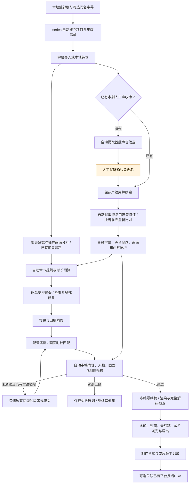

# 剧作工坊 AutoClip

把电影、单集电视剧或整季文件夹，转成有观点的中文解说短视频。

新增「声音确认台」：用 CAM++ 整理前几集的候选声音，试听原声、查看原片时间及前后画面，由人确认角色名并建立声纹库。支持无名角色、排除、撤回及后续声纹候选比对。使用方式见 [人工声纹确认](docs/人工声纹确认.md)；准备资料后可双击 `听声音认人物.command` 打开。

这是一套可执行的 Python 流水线：本地识别对白 → 人物背景与分集研究 → 抽样画面理解 → 逐集选题 → 解说脚本 → 自动审片 → 配音 → 原声穿插 → 字幕与竖屏排版 → 批量导出。

后续工作按 [分阶段迭代计划](docs/迭代计划.md) 推进，逐项记录交付物、验收标准与完成状态。

新稿会先完成本集分段分析，再结合最近三集已有台词、研究与交付稿理解前情；支持按成片时间改一句解说，并跨稿件复用未改片段。方法和独立命令见[跨集理解与局部修改](docs/跨集理解与局部修改.md)。

**可以自动生产，但模型审片通过不等于事实正确。** 已出现将八阿哥行为归给太子的错误。时间线、配音和解码有程序检查；人物归属、剧情因果和观点仍可能误判。前置研究记录证据与疑点，已接入独立人物归属拦截，但画面错配与误拒仍待改进；尚不把这一阶段当作稳定批量出片能力，详见[人物核对与前置研究](docs/人物核对与前置研究.md)。

## 整剧自动制作：只在声纹建档时人工核对

更新：2026-10-18。新增统一入口 `series`：给定本地剧集目录，系统自动建立项目、识别集数顺序、整理字幕与前情、关联声纹候选、编排章节与镜头、写稿、配音测时、内容审核、局部修复、渲染、包装和导出。**人工步骤只保留声纹建档；本轮范围到自动导出，不包含平台发布。**

第八、九集此前已经用过人工声纹库辅助制作；现在 `series` 将候选读取、当前库重新比对、逐条字幕关联和自动审核串联起来。机器候选不回写人工参考库。新入口不要求人工整理脸部参考图，也不伪造旧 `render-sample` 要求的人工审阅记录；使用独立、绑定最终稿和原片的机器审核记录。

### 已实现的流程

图中橙色是唯一的人工核对步骤。错误自动重试到配置上限，仍不通过则记录失败并继续其他集，不等待人工改稿、不把失败稿当作成片。



### 一个入口启动和续跑

安装依赖、FFmpeg、字体及模型服务密钥的方法见下方“从零安装”；声音特征依赖见[人工声纹确认](docs/人工声纹确认.md)。默认配置是通用的 `configs.series.toml`，不用先手工填写章节、人物备注或逐段审阅文件。

```bash
# 自动创建项目；剧名默认取素材目录名，支持 --series 显式指定
.venv/bin/python -m autoclip series /path/to/剧名 --output output/整剧项目

# 已有声纹库时直接使用；可复用既有全集扫描的特征清单
.venv/bin/python -m autoclip series /path/to/剧名 --output output/整剧项目 \
  --library /path/to/registry.expanded.json \
  --voice-manifest /path/to/全集扫描/manifest.json

# 首次没有声纹库时，系统准备好候选后提示唯一的人工步骤
.venv/bin/python -m autoclip voice-review --output output/整剧项目/voice-enrollment
# 确认后再次执行同一 series 命令，自动继续；已有路径会记在 project.json

# 只处理前一集进行试跑；或只准备字幕，暂不调用写稿模型
.venv/bin/python -m autoclip series /path/to/剧名 --output output/整剧项目 --limit 1
.venv/bin/python -m autoclip series /path/to/剧名 --output output/整剧项目 --stage prepare

# 制作台账自动生成；已有平台数据时可额外关联，不自动发布或抓取账号数据
.venv/bin/python -m autoclip series-report --output output/整剧项目 \
  --feedback /path/to/feedback.csv
```

`--config` 可覆盖通用配置，`--model-path` 指定本地 CAM++ 权重目录，`--voice-python` 指定声音依赖环境。默认优先使用仓库的 `.venv-voices/bin/python`。`--voice-manifest` 是含声音特征及素材指纹的清单，不是只有人名的比对报告。配置、声纹库、特征清单路径会记住；`--limit` 和 `--stage` 是本次运行选项。

首次没有人工声纹库时返回退出码2，状态为 `waiting_voice_confirmation`；完成声纹确认后重跑即可。部分集失败返回1，成功或准备完成返回0。`--stage prepare` 在尚未建声纹库时同样先准备声纹确认资料。

### 已补齐的连接与实际边界

| 能力 | 当前实现 | 验证与边界 |
| --- | --- | --- |
| 新剧初始化与整季调度 | 自动保存项目配置、自然排序数字/中文集数、逐集处理、失败隔离、阶段断点 | 输入是本地视频；软件依赖和密钥须已安装配置，不负责搜寻或下载剧集 |
| 人物证据自动关联 | 根据当前人工库重新比对特征，关联到字幕；自动审核结合声音、原片画面与问答；冲突保留未知并触发修订 | 不把说话人自动当成行为者；声纹匹配和机器审阅仍可能误判 |
| 章节预算与局部镜头修复 | 支持顺叙原声及前置高光；程序分配预算、校验范围/顺序/引用；失败章有限重写，保留其他章 | 顺叙模式按素材与时长上限分配，不强迫填满目标时长；不能保证任何素材均有可用方案 |
| 自动内容审核与定稿 | 覆盖标题、观点、口播和原声镜头；严格检查审核单位、证据与画面引用；测时后审核，修订后重新测时审核 | 保存 `automatic-review.json`，不冒充人工认可；无法通过的内容不会交付 |
| 自动渲染与导出 | 冻结核定文字，完整解码检查，水印、封面、稿件和浏览页自动生成 | 不包含平台发布；既有 `render-sample` 人工核定路径保留兼容，不是新入口的必经步骤 |
| 续跑与参考变更 | 阶段结果与产物指纹都匹配才复用；参考库变化生成影响清单并使旧审核失效，新运行保留历史版本 | 同一项目同时只允许一个生产进程；模型/素材/配置等变化会生成新运行目录 |
| 制作与反馈记录 | 自动统计完成/失败、调用和修订，生成版本ID；可选按版本关联平台、发布时间、播放量和完播率 | 没有账号数据不推断传播效果；反馈导入不是自动发布或自动获取平台数据 |

最近完整回归为 **336项通过、3项跳过**。已有自动测试覆盖了真实 FFmpeg 导出、缓存复跑、参考变更失效和失败审核拦截；其中模型与配音采用固定测试数据。真实模型的验收结果与限制记录在[迭代计划](docs/迭代计划.md)。**流程自动化已经接通，不等于任意新剧的内容质量已经得到验证。**

项目产物：

```text
整剧项目/
  project.json                 素材清单、剧名、配置和声纹路径
  series-status.json           本轮各集结果、失败原因与运行目录
  production-metrics.json      本轮调用、修订与完成/失败统计
  reference-impact.json        声纹库变更影响（发生变更时生成）
  project-report.json          当前交付版本与可选平台反馈
  feedback-template.csv        按 production_id 关联的反馈模板
  voice-enrollment/             首次声音候选及人工确认
  episodes/<集数-指纹>/
    status.json / results.json  当前状态与成片索引
    runs/<输入指纹>/stages/     各阶段完成记录及产物指纹
    runs/<输入指纹>/voice-evidence.json
    runs/<输入指纹>/automatic-review.json
  episodes/成片/               视频、封面、清单和最终稿
  episodes/index.html          本地成片浏览页
```

### 独立提纲预检与旧入口

`check-outline` 可独立检查提纲，且 `write-outline` 已在写稿前自动执行同一检查，不需要人为插入该步骤。

```bash
.venv/bin/python -m autoclip check-outline /path/to/episode.mp4 \
  --outline /path/to/outline.json --transcript /path/to/transcript.json \
  --config configs.story-yunjian.toml
```

旧短片入口 `produce` 继续支持自动选题到导出；旧长片分步命令可用于排查或复现历史定稿。整剧自动长解说使用 `series`，不把旧 `render-sample` 的人工核对要求移植到新入口。详见[加长解读与配音](docs/加长解读与配音.md)。

## 使用

后续新稿默认先做口播精修，再审查内容和人物：自然交代来源、减少审核腔与重复总结，详见[口播创作与精修](docs/口播创作与精修.md)。已核定的旧试片不自动改稿。

加长解说使用独立的章节提纲、实配测时与开发核对入口，详见[加长解读与配音](docs/加长解读与配音.md)。云扬默认改用经实际验证的微软新接口；普通短片时长不变。

**短片推荐使用独立生产入口：** 安装依赖并设置 `.env` 后，运行 `.venv/bin/python -m autoclip produce`，或双击 `生成新片.command`。它重新检查尚未出片的故事，按约3分钟生产新片，自动轮换水印、清理字幕尾部标点并导出封面；旧成片保持原样。详细步骤、质量规则、重试与运行依赖见 [独立运行与生产规范](docs/独立运行与生产规范.md)。

首次使用请先按下方“从零安装”准备 `.venv`、FFmpeg 和 `.env`，然后在项目根目录运行：

也可以在Finder双击 `生成雍正王朝.command` 批量生成，双击 `查看成片.command` 打开本地浏览页。
双击启动的素材目录通过本地 `.env` 的 `AUTOCLIP_SOURCE_DIR` 设置，默认 `videos/雍正王朝`；也可将素材目录作为启动脚本的第一个参数。真实素材目录与密钥不会进入仓库。

“爱大片儿”台标和配套封面已接入正常出片流程。每条导出同名 `MP4 + JPG`，视频全程显示透明台标，封面为独立图片，上传视频时选择它作为封面，不会在视频开头额外插入静止画面。

```bash
# 检查配置，不产生模型费用
.venv/bin/python -m autoclip doctor

# 只整理人物背景与每集带时间码的剧情资料，不制作影片
.venv/bin/python -m autoclip research "videos/雍正王朝" --config configs.production.toml

# 一集生成两条；默认约100秒，720×1280，中文男声
.venv/bin/python -m autoclip batch "videos/雍正王朝/01.mp4"

# 三集批量生成，每集两条；自动按集数顺序运行
.venv/bin/python -m autoclip batch "videos/雍正王朝"

# 按故事质量决定数量，每集0–6条，不强制凑数
.venv/bin/python -m autoclip batch "videos/雍正王朝" --clips 0

# 只先做选题、脚本和审查，不配音、不渲染
.venv/bin/python -m autoclip batch "videos/雍正王朝" --stage plan

# 本地成片浏览页，浏览器打开 http://127.0.0.1:8765
.venv/bin/python -m autoclip gallery

# 整理为直观文件名，并汇总最终解说稿到 output/成片
.venv/bin/python -m autoclip export
```

重复同一命令会复用已完成的转写、模型调用、配音和镜头缓存；某集失败不会阻止其他集。终端返回非零退出码说明有失败任务，原因记录在 `output/batch.json` 与对应集的 `status.json`。

## 配置

`configs.yongzheng.toml` 为当前三集准备。其他作品使用 `configs.generic.toml`：

```bash
.venv/bin/python -m autoclip batch "/path/to/movie.mp4" --config configs.generic.toml
```

| 配置 | 用途 |
| --- | --- |
| `series` | 作品名，影响作品标识和编导语境 |
| `style` | `auto` 根据类型选择风格，或填写具体风格要求 |
| `clips` | 正数1–10：请求固定数量；0：模型按质量选0–6条，不凑数 |
| `target_seconds` | 短片每条参考时长，45–240秒；验收范围为参考值的0.6–1.8倍，默认100对应60–180秒，不是精确的定长剪辑 |
| `min_seconds` / `max_seconds` | 可选的实际成片时长下限和上限；短片生产配置为120–240秒，覆盖上面的默认倍数范围。显式长片配置可设更宽范围，剧情先行配置为60–2700秒；不是要求填满时长 |
| `duration_profile` | `short` 为短片；`long` 使用章节写稿、测时和核定渲染路径，参考目标至少300秒，整剧自动生产用 `series`，常规 `produce` 仍用于短片 |
| `opening` | 新片配置为`original`：优先10–18秒连续高光原声开场，完整句子最多22秒；`narration`保留旧式解说开场 |
| `original_ratio_target` | 原声占比创作参考，新片为0.6；不靠无关对白凑比例，最终实际占比见成片浏览页 |
| `portrait` | `true` 竖屏保留完整原画幅；`false` 1280×720横屏 |
| `vision` | 联合画面理解，建议保持开启 |
| `asr_backend` / `asr_model` | Apple Silicon使用MLX，其他平台可使用faster-whisper |
| `asr_prompt` | 人物名等识别词表，仅作识别提示，不当作剧情证据 |
| `voice` / `tts_rate` | 合成声音与速度，默认云扬男声、+8% |
| `identity_gate` / `identity_registry` | 专门核对人物与行为归属；production开启，本地参考图须已核实，缺少配置文件会报错 |
| `research_before_produce` | 制作前生成带证据索引的分集研究初稿；production配置开启，初稿不代表身份核实 |
| `tts` | `edge` 网络合成语音；`macos` 本机婷婷语音，需显式选择 |
| `max_api_calls` | 单集单次进程的实际API尝试次数上限，含重试，不是金额上限 |
| `repair_attempts` | 新片入口初次生成后的针对性修复轮数，默认3，范围0–5；服务故障不触发重新编稿 |

同名 `.srt` 与视频放在一起时优先使用外挂字幕，例如 `01.mp4` + `01.srt`。外挂字幕必须是该版本的时间轴。没有外挂字幕时在本机分段识别，原片音频不发到语言模型。

### 数量与选题

当前三集各两条来自 `clips=2` 的初始配置，**不代表每集只有两个高光**。自动模式会结合候选、完整字幕、故事完整度、独立角度和时长要求决定0–6条。这个上限控制产量与费用，并非作品可用看点的上限；判断仍来自模型。每条继续通过时间线、证据、重复率和语义检查。无合格选题可返回零条。

增量挖掘新故事并保留旧片，请使用 `produce` 或 `生成新片.command`，默认每集最多推荐3个新候选，可设 `--max-new 6` 扩大候选上限，最终只导出通过检查的成片。双击 `按看点自动生成.command` 则运行旧批次的自动数量模式，会重新选题、调用模型并可能生成不同稿件。切换为自动数量时不会套用原来按镜头序号编写的 `editor_notes.json`，姓名勘误词表仍然生效。原 `生成雍正王朝.command` 使用配置数量。

### 爱大片儿水印与封面

品牌配置在 `branding.toml`，`watermarks` 列表中的白金款和朱红白款按成片序号交替使用；单条视频与封面保持同款。`watermark_width` 为画面宽度比例，`watermark_opacity` 为不透明度，`enabled=false` 可关闭整个品牌包装阶段。默认左上角，避开正文标题和字幕。每次从无水印原始渲染生成，避免重复叠加。

每条封面默认1080×1920；横屏视频为1920×1080。从该条已使用的原声镜头及开场镜头中抽帧，按亮度、对比度和清晰度择图，再排版剧名、该条已核查标题及账号台标。它是程序自动排版的真实原片封面，不使用生成式人物图，也不依赖新的付费图像调用；目前没有人脸表情优选。中文字体可以在 `branding.toml` 的 `font` 字段指定。

`output/成片` 内视频与封面同名，浏览页同时提供“下载成片”和“下载封面”。`published/` 保存品牌版、封面、所选原片时间和水印参数，`renders/` 保留无台标原始渲染。台标由内置 image_gen 制作，完整提示词见 `assets/brand/设计说明.md`。

### 模型密钥

生产默认使用OpenCode Go订阅，配置已指定Go专用接口与DeepSeek V4.1 Flash：

```dotenv
OPENCODE_API_KEY=你的Go密钥
LLM_BASE_URL=https://opencode.ai/zen/go/v1
LLM_MODEL=deepseek-v4.1-flash
```

`configs.production.toml`中的模型和接口优先于环境变量。不要把Go专用地址写成按量付费的Zen地址`/zen/v1`。程序使用自己的客户端名称和稳定的`x-opencode-session`标识，不伪装为其他客户端；额度或权限失败时不会自动转到DeepSeek官方付费接口。Go有使用限额，额度不是无限；服务端的超额计费设置需在OpenCode控制台管理。参阅[Go官方说明](https://opencode.ai/docs/go/)。

已用实际Go key验证文本JSON及带图请求，服务端返回`deepseek-v4.1-flash`；图片测试正确读取水印和剧名，不代表人物归属准确率已通过验收。请求缓存保留实际接口和返回模型，新请求与旧缓存统计分开解释。

若主动改用DeepSeek官方，在所用配置中明确设置`llm_base_url = "https://api.deepseek.com"`、`llm_model = "deepseek-flash"`并设置`DEEPSEEK_API_KEY`。若旧环境将官方密钥存成`DASHSCOPE_API_KEY`，确认它确实来自DeepSeek后才可启用`DEEPSEEK_USE_DASHSCOPE_ALIAS=true`。Go只使用`OPENCODE_API_KEY`；两个平台的密钥不混用。

## 产物

```text
output/
  index.html                  成片浏览页
  batch.json                  本轮批处理结果
  01-<素材指纹>/
    source.json               素材路径与指纹
    transcript.json / .srt     带绝对时间码的识别结果
    analysis.json             分段剧情、画面观察、候选与评分
    plan.json                 审查后的编导脚本
    review-*.json             模型审片记录
    usage.json                缓存请求与输入/输出token汇总
    status.json               当前阶段、耗时、失败原因
    results.json              当前成片清单
    published/01-<版本>/
      video.mp4               带爱大片儿台标的成片
      cover.jpg               独立配套封面
      manifest.json           水印参数、封面原片时间及最终稿
    renders/01-<版本>/
      video.mp4               最终成片
      subtitles.ass / .srt    成片字幕
      manifest.json           最终口播、原片/成片时间映射、技术质检
```

`plan.json` 是配音前的稿件，`manifest.json` 是实际成片的最终稿，可能包含为匹配配音时长做的缩写或扩写；这类改写还会再做事实复核。语音字幕使用服务返回的句子边界，句内短句按长度分配时间，**不是逐字强制对齐**。原声段保留原片自带字幕，避免重复覆盖。

可选编辑反馈保存在对应集的 `editor_notes.json`。它按视频与镜头序号记录明确的修改意见，触发模型修订与重新审查；首集样片验收时使用了这项人工反馈功能。选题、写稿、审片均默认使用 `deepseek-flash`（当前为V4.1 Flash），不自动升级到Pro。模型审片也会误判，不能替代内容验收。

已核实的姓名错字可以写入对应集的 `text_corrections.json`，例如 `{"origin":"第三集2214.8秒原片字幕核实为邬先生", "replacements":{"吴先生":"邬先生"}}`。它只校正文字，不重写剧情或修改原始识别证据，重跑会重新生成受影响的配音、字幕和成片。第三集样片使用了这项勘误。剧情与人物归属修改应使用上述 `editor_notes.json` 并重新审查。

`usage.json` 汇总该集已缓存请求，包含历史配置下的请求；`calls_this_run` 是本轮实际尝试次数。失败请求是否计费以服务商账单为准。本地识别与剪辑消耗本机算力，DeepSeek调用按服务商账单计费；Edge配音不是带SLA的付费生产服务。

## 从零安装

推荐 Python 3.12、FFmpeg（包含libass）、中文字体。当前支持macOS/Linux命令行，任务文件锁使用Unix接口。

```bash
uv venv --python 3.12
uv pip install --python .venv/bin/python -e '.[mac,dev]'  # Apple Silicon
# 或：uv pip install --python .venv/bin/python -e '.[cpu,dev]'
cp .env.example .env
```

非Apple Silicon配置：`asr_backend="faster"`、`asr_model="large-v3"`。本实现的faster-whisper后端使用CPU int8；如需CUDA，应扩展后端设备配置。Linux建议安装Noto CJK字体，libass会使用字体回退。首次识别下载模型；如果Hugging Face传输卡住，可设 `HF_HUB_DISABLE_XET=1`。已有模型缓存优先本地读取。

## 验证

```bash
.venv/bin/python -m pytest -q
```

测试覆盖：越界、倒序、无依据字幕引用、重复选题、SRT解析、密钥平台隔离、模型缓存、素材变更失效、自动数量允许零条，以及FFmpeg真正生成含字幕、水印和音轨的竖屏视频并完整解码。还校验品牌包装前后音频内容哈希一致、重复运行不会重复叠水印、封面取图落在已选镜头内。

方法论、已实现能力和后续生产建议见 [docs/方法论.md](docs/方法论.md)。

字幕识别争议可使用[原片字幕证据核对工具](docs/字幕证据核对.md)，保留截图与时间对齐依据；v1.1新增可撤销纠错层，通过`produce --subtitle-layer`启用，不覆盖原始字幕或已有影片。长期任务与本轮验收结果持续维护在[迭代计划](docs/迭代计划.md)，版本变化见[更新记录](CHANGELOG.md)。

接口依据：[DeepSeek图片输入](https://api-docs.deepseek.com/guides/vision/)、[DeepSeek模型](https://api-docs.deepseek.com/)、[MLX Whisper](https://github.com/ml-explore/mlx-examples/tree/main/whisper)、[Edge TTS](https://github.com/rany2/edge-tts)、[OpenCode Go](https://docs.opencode.ai/docs/go/)。

## 仓库内容

仓库包含源代码、测试、配置模板、方法论与“爱大片儿”透明台标。真实 `.env`、影视原片、字幕与音频素材、生成成片/封面、运行记录、模型缓存、虚拟环境和系统文件均被 `.gitignore` 排除。`.env.example` 只包含空密钥和通用目录示例。

人物参考已支持同一角色的多个角度，并把先行认脸与逐条发言归属分开；新稿会先整理完整冲突提纲。独立命令、实际对照结果及局限见[人物复用与完整冲突提纲](docs/人物复用与完整冲突.md)。

## 人物归属核对与两版文案试验

新增`identity-audit`和`compare-scripts`命令，前者核对已有稿件，后者生成描述版/分析版并最多修订两轮；均不修改旧影片。分析必须进入实际口播，不能只写在备注中。配置、输出、独立运行方式及当前失败边界见[人物归属独立检查](docs/人物归属独立检查.md)。本机人物参考图和素材不会随Git分发，新机器需要恢复自己的本地资料。

开发核对的风格试片可使用`render-sample`复现：它要求绑定原片、稿件、字幕和抽帧的逐项核对记录，禁止自动改稿，与无人复核`produce`分开。第四集试片与命令见[解读样片评估](docs/解读样片评估.md)。
